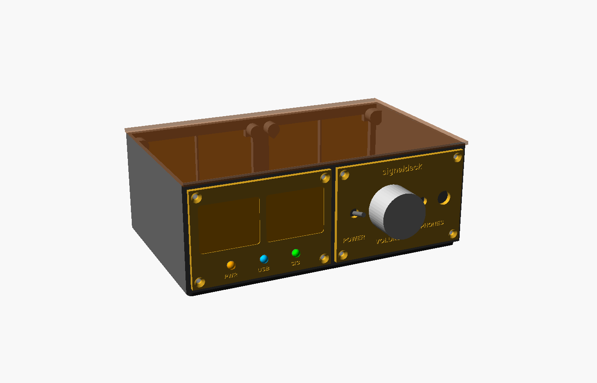
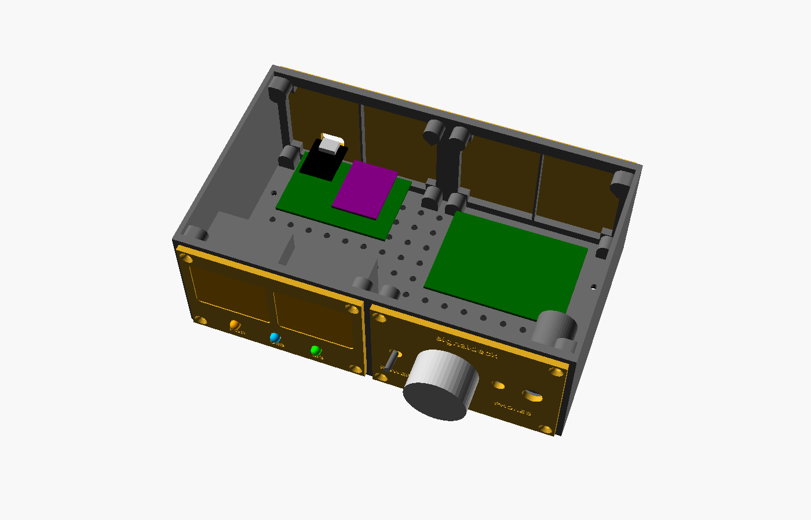
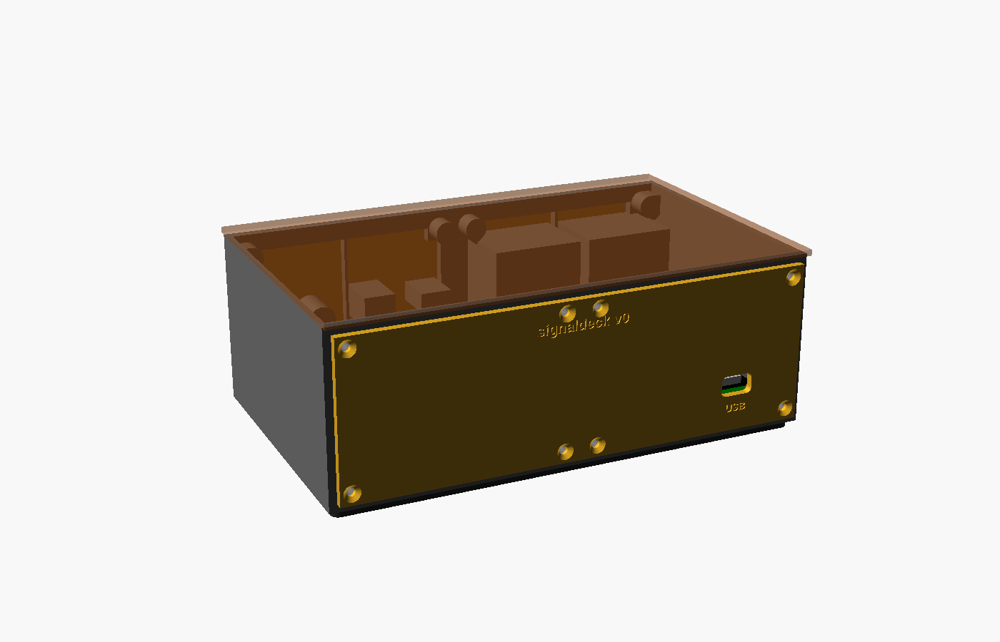
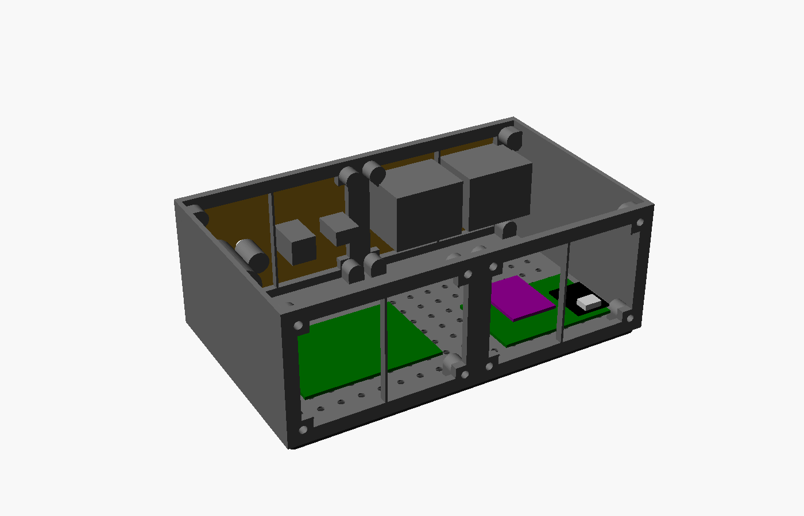

# Enclosure v0 — first printed prototype (M3)

A cheap first case for trying out where everything goes: boards, knob, sockets, toggle, meters.
It is **not** the final design. The printed panels stand in for brass, the meters are placeholder
windows, and the floor is a grid of holes so boards can be moved without reprinting. What you learn
here feeds the amp PCB outline (M4) and the final enclosure (M6, `docs/enclosure.md`).

| | |
|---|---|
| Outside size | 190 × 115 × 70 mm (W × D × H); 121 mm deep with the front panels and rear plate, 73 mm tall with the steel base (plus feet) |
| Parts | printed: `tray` (floor, side walls, front and rear frames), `panel_left`, `panel_right`, `panel_rear`, `lid`; laser-cut steel: `base` |
| Source | `enclosure_v0.scad` (OpenSCAD, parametric: every size is a named number at the top) |
| Export | `./export.sh` → `stl/*.stl` in print orientation, `dxf/base_plate.dxf` for laser cutting, `images/*.png` (STL/DXF are not committed) |

### Rear: a frame and a plate, like the front

The back is not a solid wall. It is a mirror image of the front frame (two windows, eight screw
bosses), with one removable **rear plate** screwed on from behind. For v0 the plate only has a USB-C
opening. You can:

- **leave the plate off** while testing: the open back gives easy access to the boards and cables;
- print the simple plate when you want the case closed;
- later make a plate (printed, aluminium or brass) with holes for exactly your sockets
  (USB-C, line out, ...). The screw pattern is the same as the two front panels, so two half-width
  plates fit as well.

| With the rear plate | Open back |
|---|---|
|  |  |

## How the electronics are arranged

**Not all on one board.** Two carrier boards plus the front-panel parts, matching the modular plan:

1. **Main carrier** (perfboard ~4 × 6 cm): RP2040-Zero and the PCM5102A module plugged into
   female headers, so both can be removed. The I2S wires between them stay short (3 MHz clock).
   It also carries the headers for the amp connector, encoder, LEDs and toggle.
   It sits at the rear, with the RP2040-Zero's USB-C reaching the rear-wall opening.
2. **Amp board**: the stage 1 NJM4556A perfboard (~5 × 7 cm), behind the right panel, near the
   jacks, so headphone wires are short. It connects to the main carrier through the 8-pin
   amp-module connector (`docs/pinout.md`). Later the OPA1622 board (P2) takes its place.
3. **Front-panel parts** (jacks, encoder, toggle, LEDs) mount on the panels with their own nuts,
   with wires going back to the boards through small connectors (JST-XH). That way a panel can come
   off without desoldering.

Why separate: the amp can be swapped without touching the digital side, analog wiring stays away
from the digital part, and each board can be tested on its own.

## How things are mounted

- **Boards → floor grid.** The holes are 10.16 mm apart, exactly 4 perfboard holes, so drilling
  out perfboard holes that are 4 apart (to 3.2 mm) lines them up with the grid. Use M3 nylon hex
  standoffs, female-female, 10 mm (nylon doesn't conduct, so it can't short a solder joint): an
  M3 × 6 screw from the top through the board, and an **M3 × 6 countersunk** screw from underneath.
  The grid holes are countersunk on the underside, so those heads sit flush and the steel base
  lies flat over them.
- **Hot glue is fine for v0** for the standoffs, wires, and anything you're still moving around.
  It peels off PLA/PETG fairly cleanly. Two exceptions: don't glue the modules themselves (glue the
  carrier, not the RP2040-Zero or the DAC), and **screw down the main carrier**, because the USB
  cable pushes on it every time you plug it in.
- **USB-C opening (rear plate).** Its position (`usb_pos`) is a guess. Put the main carrier so the
  RP2040-Zero's USB-C edge sits right behind the plate (it may stick into the frame window).
  Then measure the height of the USB-C centre above the floor and its distance from the left side
  (seen from the front), set `usb_pos`, and export only `panel_rear` again. No tray reprint is
  needed. (Later option: a short panel-mount USB-C extension in a custom rear plate.)
- **Steel base → tray:** held by the four lid screws (see below). **Feet** go on the steel: stick-on
  rubber feet or rubber rings, any height, placed near the corners.

## Steel base plate (weight + clean underside)

A 3 mm steel plate under the tray: it adds about **485 g**, so the case doesn't slide when you
plug in headphones or turn the knob, and it hides the grid holes. It's set in 2 mm from the edges, so
from the side it reads as a dark shadow line under the case, the classic "floating" hi-fi look.

| | |
|---|---|
| Size | 186 × 111 × 3 mm, corners R3 |
| Holes | 4 × Ø3.4 mm, **countersunk 90° to Ø6.5 mm on the underside** (for the lid screws) |
| File | `dxf/base_plate.dxf` (outline + holes; it's 2D, so the countersinks are not in it) |
| Material | Mild steel (S235 / DC01), black powder coat or paint; or 3 mm stainless if you want it bare |

**Ordering:** any online laser-cutting service takes the DXF. Choose 3 mm steel and quantity 1. Some
services offer countersinking as an option: give them the four holes and "90°, Ø6.5". If not, do it
yourself with a countersink bit in a drill (slow speed, a drop of oil); test the depth with a screw
until the head sits flush. 2 mm steel would be lighter and cheaper, but too thin for a countersunk
M3 head. Before ordering, you can test the fit with a printed `stl/base.stl` mock-up.

Feet: rubber rings or stick-on feet on the steel, about 15 mm in from the corners (clear of the
screw heads).

## Screws: one type, brass inserts, nothing on top

Every removable part uses **M3 countersunk screws** (flat head) going into **brass heat-set
inserts**: M3 × 8 for the panels and rear plate (16), M3 × 10 for the lid (4), 20 inserts in total.

**Why inserts.** A screw driven straight into plastic cuts its own thread. That thread wears out after
5–10 assemblies, and it feels gritty. A heat-set insert is a small brass sleeve, threaded inside and
knurled outside. You press it into a slightly smaller hole with a hot soldering iron; the plastic
melts around the knurls and grips it for good. After that the screw turns in brass: smooth, the same
every time, and good for hundreds of cycles.

**Why countersunk.** The hole has a 90° cone, so the head sits flush with the surface (0.2–0.3 mm
below). With black screws on the panels it looks deliberate, like an instrument. Torx (ISO 14581) or
hex socket (ISO 10642) both work; they don't slip and scratch the panel the way Phillips does.

| Joint | Screws | Insert sits in |
|---|---:|---|
| Left and right front panels → front frame | 8 × M3 × 8 | the frame (pressed in from the front face) |
| Rear plate → rear frame | 8 × M3 × 8 | the rear frame (pressed in from the back face) |
| Steel base + lid → tray | 4 × M3 × 10 | the bottom end of the lid's four posts |

**The lid.** It has four posts that hang down inside along the side walls. Screws come up through the
steel base (countersunk) and the floor into the inserts at the bottom of the posts. So four screws hold
lid, tray and base together, and the top stays completely clean. The posts stop 0.3 mm above the
floor, so tightening pulls the lid firmly down onto the walls. To open: turn the case over, undo four
screws, lift off the base, turn back, lift the lid.

**Pressing the inserts (once, after printing).**
1. Check the insert's spec sheet for its hole size and set `insert_hole` / `insert_len` before
   exporting (defaults: 4.0 mm hole, 5.7 mm long insert, which suits the common M3 × 5.7 type).
2. Soldering iron at about 220 °C for PLA or 240 °C for PETG. An insert-setting tip is easiest; a
   conical tip works too.
3. Set the insert on the hole, rest the iron in it, and let it sink in under light pressure, with no
   forcing. Stop when it's flush. Lift the iron straight up, then press the insert flat with
   something cold and flat (e.g. the side of a metal ruler) for a few seconds.
4. Keep the part so the hole points straight up: the tray on its back for the front frame, on its
   front for the rear frame; the lid upside down.

**Tightening:** snug, not hard. The cone centres the panel. Over-tightening can crack a printed
panel or pull an insert.

**For the brass panels (M6):** an M3 countersunk head is ~1.7 mm tall, too much for 2 mm brass. Use
M2.5 countersunk, M3 button heads with a thin nylon washer, or hidden studs on the back of the panel.
To be decided in M6.

## Before you order a print

Measure your real parts and set these numbers at the top of the `.scad` file (each is marked MEASURE):

| Parameter | What |
|---|---|
| `toggle_hole`, `enc_hole`, `jack35_hole`, `jack635_hole` | Thread diameter of each part + 0.2 mm |
| `led_hole` | 5.1 for a bare 5 mm LED, about 8 for a holder or bezel |
| `knob_d` | Your knob, to check it clears the toggle and jacks |
| `carrier`, `amp_board` | Board sizes (only used in the preview) |
| `usb_pos` | See above; can also be fixed later with a file |
| `insert_hole`, `insert_len` | From the inserts' spec sheet |

Also check: each bushing or thread must be long enough for the 3 mm panel **plus** its nut.

Then run `./export.sh` and open the STLs in any viewer (macOS Preview shows them) as a final check.

## Printing (online service)

Checked on the exported STLs, looking for downward-facing surfaces steeper than 45° that are not
on the print bed:

| Part | Size (print orientation) | Orientation | Supports | Notes |
|---|---|---|---|---|
| `tray` | 190 × 115 × 67.6 mm | upright, floor down | **none** | Window tops are bridges, halved to ~34 mm by snap-off ribs. Screw bosses: the bottom ones are solid blocks rising from the floor, the top ones are teardrops (45° underside), merged into the side wall at the corners so no thin slots are left. Floor countersinks face the bed (45° cone, fine). |
| `lid` | 190 × 121 × 67.3 mm | top side down, posts up | none | Four 10 × 10 mm posts, 65 mm tall: print them with 3–4 walls. |
| `panel_left`, `panel_right` | 90 × 61.6 × 3 mm | face down | none | Labels and countersinks on the bed side come out crisp. |
| `panel_rear` | 184 × 61.6 × 3 mm | face down | none | Same. |

- **Snap-off ribs.** Each frame window has a thin 1.2 mm rib in the middle, there only to hold up the
  window top while printing. Cut them off with flush cutters at top and bottom, and clean up with a
  file. If you order SLS/MJF, or your printer bridges 71 mm cleanly, set `breakaway_ribs = false`.
- **Material:** PETG (better near warm electronics, holds inserts well) or PLA for a pure mockup.
  0.2 mm layers, 3–4 walls (inserts and posts need solid plastic around them), 20–30 % infill.
- **Bed size:** the largest part is 190 × 121 mm, fine for the usual 220 × 220 mm and larger
  printers that online services use.
- **Services:** upload the five STLs (not `base.stl`, that one is steel), choose FDM + PETG, and say "no supports" (or let them decide).
  SLS/MJF nylon looks more finished but costs more. Ask the service not to scale the parts: holes
  and inserts depend on exact sizes.

## Shopping list for v0

| Item | Qty |
|---|---:|
| M3 × 8 countersunk screws, black (ISO 14581 Torx or ISO 10642 hex) | 16 (buy 50) |
| M3 × 10 countersunk screws, same type (lid + base) | 4 |
| Steel base plate, laser cut, 3 mm (see above) | 1 |
| M3 heat-set brass inserts, ~4.0 mm hole, 5.7 mm long (check the spec) | 20 (buy 50–100) |
| Torx T10 driver or 2 mm hex key, to match the screws | 1 |
| Soldering-iron tip for inserts (optional, makes it easier) | 1 |
| M3 nylon hex standoffs, female-female, 10 mm (an assortment kit is easiest) | 8–10 |
| M3 × 6 screws (board side) + M3 × 6 countersunk (floor side) | 8–10 each |
| Rubber feet or rubber rings for the steel base | 4 |
| Perfboard 4 × 6 cm and 5 × 7 cm (if not already for the amp) | 1 + 1 |
| Female 2.54 mm headers (sockets for RP2040-Zero and DAC) | 1–2 strips |
| JST-XH connectors and crimped leads (panel wiring) | assortment |

## What to record (→ `docs/build-log.md`, Milestone 3)

- Does everything fit through the frame windows? Any part hitting another part, or the lid?
- Final positions of the boards (grid coordinates) and the space left for the meter driver.
- **For M4:** the largest outline the amp PCB can have, where its mounting holes go (on the 10.16 mm
  grid makes v0 reusable), and which edge the connector and jacks wiring should leave from.
- What you'd change for the final enclosure: size, knob/jack spacing, meter size.
